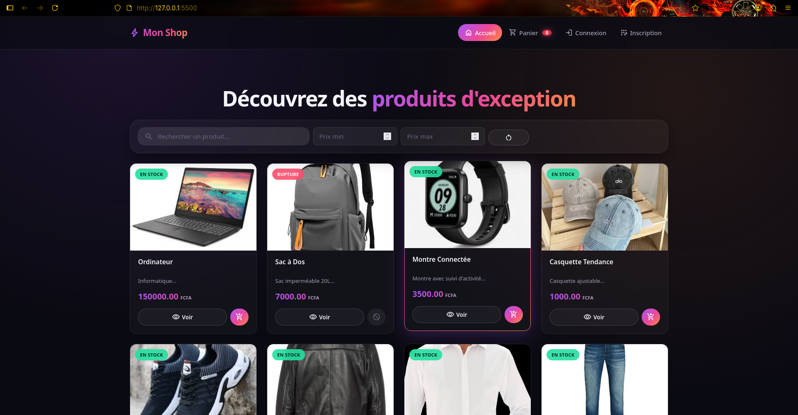
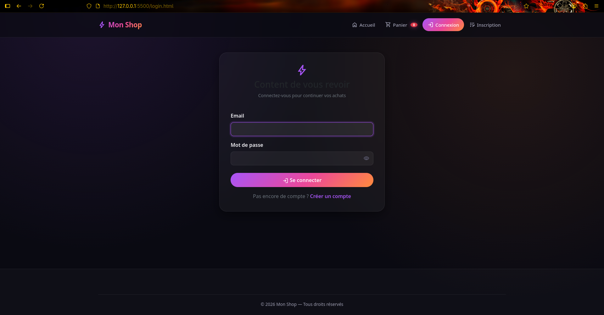
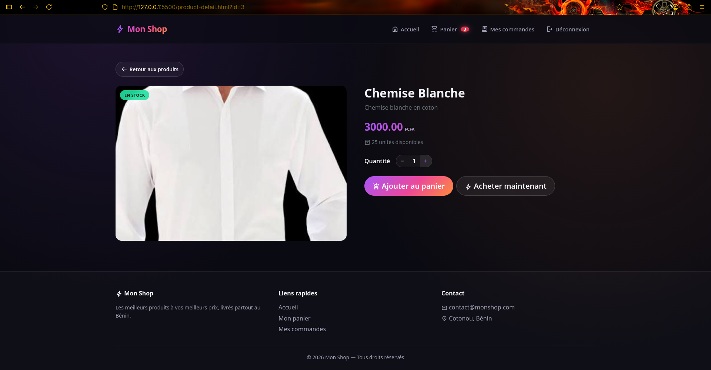
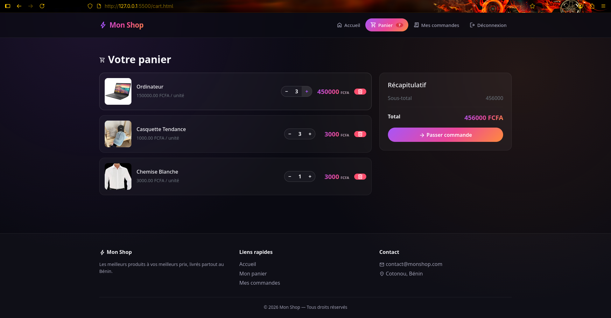
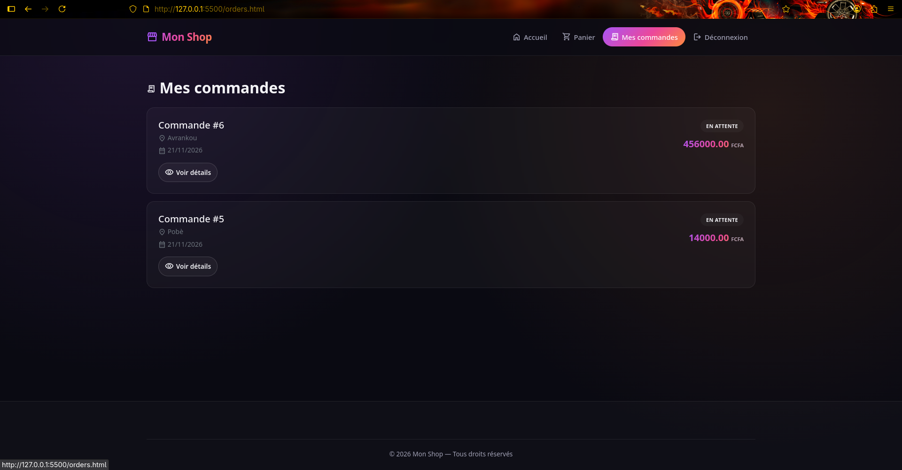

# 🛍️ Mon Shop — Full Stack E-commerce

\<p align="center">
&#x20; \<strong>Application e-commerce développée avec Django REST Framework et JavaScript.\</strong>
\</p>

\<p align="center">
&#x20; \
&#x20; \
&#x20; \
&#x20; \
&#x20; \
&#x20; \
\</p>

---

## 📌 Présentation

**Mon Shop** est une application web e-commerce Full Stack réalisée dans le cadre du stage **Full Stack Development chez [CodeAlpha](https://www.codealpha.tech)** — Tâche 1 : *Simple E-commerce Store*.

L'application permet aux visiteurs de parcourir un catalogue de produits, aux clients de créer un compte, de gérer leur panier et de passer des commandes.

Elle intègre également une interface d'administration Django permettant de gérer les produits, les utilisateurs et les commandes.

Le projet repose sur une architecture séparant le frontend et le backend, avec une communication assurée par une API REST et une authentification basée sur JWT.

### 🎯 Objectifs du projet

- Concevoir et développer une application e-commerce fonctionnelle.
- Mettre en pratique le développement backend avec Django et Django REST Framework.
- Développer une interface utilisateur dynamique en JavaScript.
- Implémenter une authentification basée sur JWT.
- Gérer les produits, les paniers et les commandes.
- Structurer une application avec une architecture frontend/backend séparée.

---

## ✨ Fonctionnalités

### 🌐 Espace visiteur

- Consultation du catalogue de produits.
- Recherche de produits par nom.
- Filtrage par catégorie et fourchette de prix.
- Consultation des détails d'un produit.
- Visualisation des images, descriptions et stocks disponibles.
- Ajout de produits au panier sans authentification.

### 👤 Espace client

- Inscription et connexion sécurisées par JWT.
- Gestion du panier :
  - Ajout de produits.
  - Modification des quantités.
  - Suppression de produits.
- Vérification de la disponibilité du stock.
- Passage de commandes avec adresse de livraison.
- Consultation de l'historique des commandes.
- Consultation des détails de chaque commande.

### ⚙️ Espace administration

Interface d'administration basée sur Django Admin.

- Gestion du catalogue de produits.
- Ajout et modification des produits.
- Gestion des images et des stocks.
- Gestion des utilisateurs.
- Consultation et suivi des commandes.

---

## 🛠️ Stack technique

| Domaine                  | Technologies                       |
| ------------------------ | ---------------------------------- |
| Frontend                 | HTML5, CSS3, JavaScript ES Modules |
| Framework CSS            | Bootstrap 5                        |
| Backend                  | Python, Django 6                   |
| API REST                 | Django REST Framework              |
| Authentification         | JSON Web Token (Simple JWT)        |
| Base de données          | SQLite                             |
| Communication            | Fetch API, django-cors-headers     |
| Serveur de développement | Django Development Server          |

---

## 🏗️ Architecture du projet

Le projet adopte une architecture **Frontend / Backend séparée**.

- **Frontend :** interface utilisateur et interactions avec l'API.
- **Backend :** logique métier, authentification et gestion des données.
- **Base de données :** stockage des utilisateurs, produits et commandes.

### Structure des dossiers

```text
CodeAlpha_Ecommerce/
│
├── backend/
│   ├── ecommerce_api/       # Configuration principale Django
│   ├── products/            # Gestion des produits
│   ├── users/               # Utilisateurs et authentification
│   ├── orders/              # Gestion des commandes
│   ├── media/               # Images des produits
│   └── manage.py
│
├── frontend/
│   ├── index.html
│   ├── login.html
│   ├── register.html
│   ├── product-detail.html
│   ├── cart.html
│   ├── checkout.html
│   ├── orders.html
│   ├── order-detail.html
│   ├── order-confirmation.html
│   │
│   ├── css/
│   │   └── style.css
│   │
│   └── js/
│       ├── config.js
│       ├── auth.js
│       ├── products.js
│       ├── product-detail.js
│       ├── cart.js
│       ├── orders.js
│       └── register.js
│
├── screenshots/             # Captures d'écran de l'application
│   ├── ecran_accueil.png
│   ├── ecran_connexion.png
│   ├── ecran_detail_produit.png
│   ├── ecran_panier.png
│   └── ecran_commandes.png
│
├── requirements.txt
└── README.md
```

---

## 🚀 Installation et exécution locale

### Prérequis

- Python 3.10 ou supérieur.
- pip.
- Git.
- Un navigateur web récent.

### 1. Cloner le dépôt

```bash
git clone git@github.com:jeanbaptisteassogba87-jpg/CodeAlpha_Ecommerce.git

cd CodeAlpha_Ecommerce
```

### 2. Configurer le backend

Accéder au dossier backend :

```bash
cd backend
```

Créer un environnement virtuel :

```bash
python3 -m venv env
```

Activer l'environnement virtuel sous Linux/macOS :

```bash
source env/bin/activate
```

Installer les dépendances :

```bash
pip install -r requirements.txt
```

Appliquer les migrations :

```bash
python manage.py migrate
```

Démarrer le serveur Django :

```bash
python manage.py runserver
```

Le backend sera accessible à l'adresse :

[**http://127.0.0.1:8000/**](http://127.0.0.1:8000/)

### 3. Lancer le frontend

Ouvrir un deuxième terminal depuis la racine du projet :

```bash
cd frontend
```

Démarrer un serveur HTTP local :

```bash
python3 -m http.server 5500
```

Accéder à l'application :

[**http://127.0.0.1:5500/index.html**](http://127.0.0.1:5500/index.html)

> ⚠️ Le backend doit rester actif pendant l'utilisation du frontend, car les données sont récupérées depuis l'API Django.

---

## 🔑 Accès à l'administration

Aucun identifiant administrateur n'est fourni dans le dépôt.

Pour créer ton propre compte administrateur, place-toi dans le dossier `backend` et exécute :

```bash
python manage.py createsuperuser
```

Renseigne les informations demandées.

L'interface d'administration est accessible ici :

[**http://127.0.0.1:8000/admin/**](http://127.0.0.1:8000/admin/)

Pour tester l'application en tant que client, crée directement un compte depuis la page d'inscription.

---

## 🔌 Documentation de l'API REST

Les principaux endpoints exposés par le backend sont les suivants :

| Méthode | Endpoint              | Description                   | Authentification |
| ------- | --------------------- | ----------------------------- | ---------------- |
| GET     | `/api/products/`      | Liste des produits            | Non              |
| GET     | `/api/products/<id>/` | Détail d'un produit           | Non              |
| POST    | `/api/users/`         | Inscription                   | Non              |
| POST    | `/api/token/`         | Connexion et obtention du JWT | Non              |
| GET     | `/api/orders/`        | Historique des commandes      | Oui              |
| GET     | `/api/orders/<id>/`   | Détail d'une commande         | Oui              |
| POST    | `/api/create_order/`  | Création d'une commande       | Oui              |

### Authentification

Les endpoints protégés nécessitent un token JWT transmis dans l'en-tête HTTP :

```http
Authorization: Bearer <access_token>
```

---

## 📸 Captures d'écran

Voici un aperçu des principales interfaces de l'application **Mon Shop**.

### 🏠 Page d'accueil

Présentation du catalogue de produits et de l'interface principale.



### 🔐 Page de connexion

Interface permettant aux utilisateurs de se connecter à leur compte.



### 🛍️ Détail d'un produit

Présentation des informations détaillées d'un produit.



### 🛒 Panier

Gestion des produits sélectionnés avant la validation de la commande.



### 📦 Commandes

Consultation des commandes enregistrées.


---

## 🔮 Améliorations envisageables

Plusieurs évolutions pourront être apportées au projet :

- Mise en place d'un système de renouvellement automatique des tokens JWT.
- Ajout de la pagination du catalogue de produits.
- Intégration d'un système d'avis et de notation.
- Notifications par email lors de la création ou de la validation d'une commande.
- Intégration d'une solution de paiement en ligne.
- Ajout de tests automatisés pour le frontend et le backend.
- Amélioration de la journalisation et de la gestion des erreurs.
- Préparation du projet pour un futur déploiement en production.

---

## 👨‍💻 Auteur

**Jean-Baptiste Assogba**

Étudiant en Licence 3 — Systèmes Informatiques et Logiciels (SIL).

Développeur orienté Full Stack, avec un intérêt particulier pour le développement backend, la conception de bases de données et l'architecture des applications.

Projet réalisé dans le cadre du stage **Full Stack Development de CodeAlpha**.

---

\<p align="center">   \<strong>Développé avec passion et curiosité pour le développement web. 🚀\</strong> \</p>
